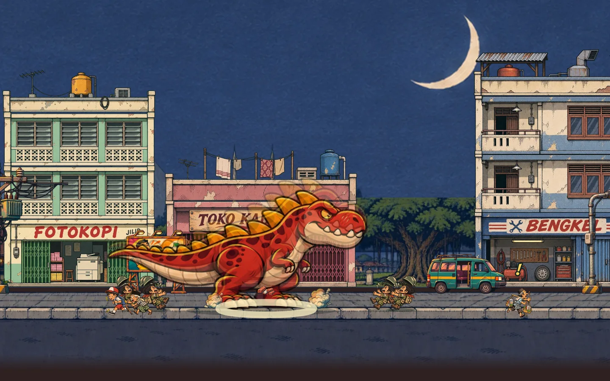
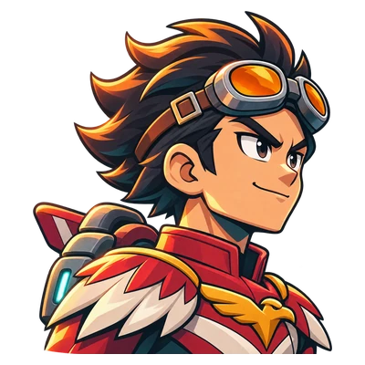
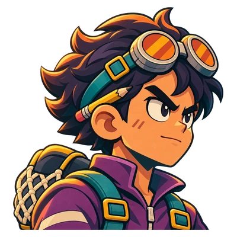
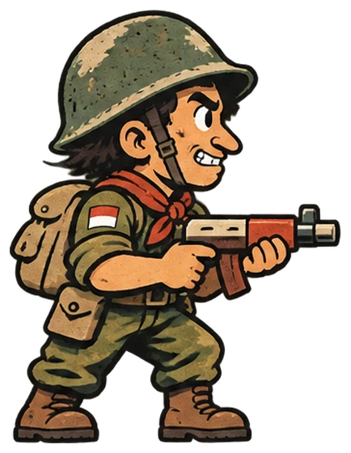
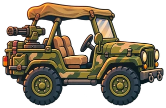
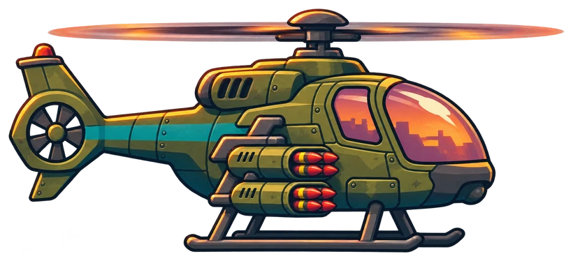
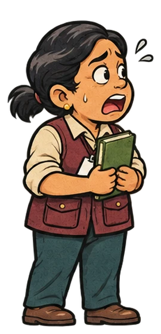
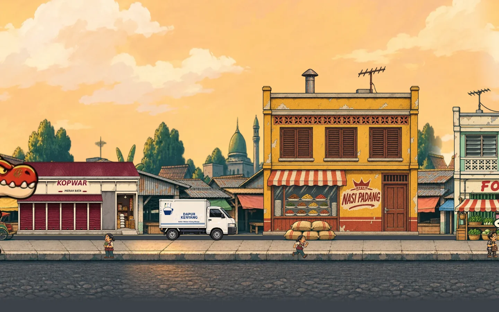

# Rampage Rex

**Game 2D di browser: kamu jadi Rex, dan kota Ruko Senja ada di depanmu.**

Ratakan bangunan lantai demi lantai, hadapi gerombolan tentara, dan kalahkan tiga pahlawan penjaga kota di delapan distrik.

Bisa dimainkan dengan keyboard, mouse, atau layar sentuh.

  
  

---

## Kisahnya

Suatu malam, sebuah meteor jatuh di hutan pinggir kota. Di dasar kawahnya ada sebutir telur, dan dari telur itu menetas Rex. Ia tumbuh besar di hutan sampai hutan tidak lagi cukup, lalu di kejauhan ia melihat kota.

Kisah ini diceritakan lewat opening komik bergerak setelah kamu menekan **Mulai main**.

## Tujuan

Di setiap distrik:

1. **Ratakan 100% bangunan.** Runtuhkan lantai dasar untuk menjatuhkan semua lantai di atasnya.
2. **Kalahkan ketiga pahlawan penjaga.** Mereka datang bersamaan begitu kota cukup hancur.
3. **Jalan ke ujung distrik.** Tentara kabur dan panah muncul di ujung jalan. Bawa Rex ke sana, lalu ia berjalan keluar layar menuju distrik berikutnya.

Kalau darah Rex habis, Rex terhuyung lalu tumbang, dan distrik diulang dari awal.

Saat pertama kali bermain, tutorial singkat di Jalan Ruko memandu enam langkah: berjalan, menggigit, meruntuhkan lantai dasar, melempar tentara dengan ekor, melompat, dan memakai ulti. Tentara baru datang setelah tiga langkah pertama selesai. Tutorial bisa dilewati, dan bisa diulang dari Pengaturan.

Progres tersimpan otomatis. Setiap distrik yang selesai membuka distrik berikutnya, dan tombol **Pilih distrik** di menu membawamu langsung ke distrik mana pun yang sudah terbuka, lengkap dengan skor terbaiknya.

## Kontrol

| Aksi | Keyboard | Mouse | Cooldown |
| --- | :-: | :-: | :-: |
| Jalan | `A` `D` atau `←` `→` | | |
| **Gigit** di depan, mengenai lantai teratas | `W` | Klik kiri | 0,7 dtk |
| **Ekor** ke belakang, melempar tentara dan jeep | `Q` | Klik kanan | 2,2 dtk |
| **Injak** di sekitar kaki, merusak lantai dasar | `S` | | 3,5 dtk |
| **Raung**, membuat tentara di layar terpaku | `E` | | 9 dtk |
| **Lompat gertakan**, kebal di udara dan membuat semua di layar terpaku saat mendarat | `Spasi` | | 20 dtk |
| **Ulti: Amukan Rex**, mengguncang seluruh layar | `R` | | 40 dtk |
| Jeda | `Esc` atau `P` | | |

Di HP atau tablet, pakai tombol arah dan tombol aksi di bagian bawah layar. Daftar kontrol lengkap bisa dibuka kapan saja dari tombol **Kontrol** di layar jeda.

Menu **Pengaturan** (dari menu utama atau saat jeda) berisi pilihan bahasa **Bahasa Indonesia** atau **English**, mode grafis **Otomatis**, **Tinggi**, atau **Ringan** (untuk HP lama), tingkat kesulitan **Santai**, **Normal**, atau **Ngamuk**, volume efek suara dan musik, getaran dan ukuran tombol sentuh di HP, serta tombol untuk menghapus progres.

Musik chiptune dibuat langsung oleh game: lagu menu, lagu bertarung yang sedikit lebih cepat saat Rage penuh, lagu khusus saat Robot Penjaga muncul, lagu mars saat pawai lewat, serta jingle pendek saat menang atau kalah.

  
  

### Kombo dan bintang

Setiap serangan yang mengenai sesuatu menambah **kombo**. Setiap 10 hit menaikkan pengali skor ×0,5, sampai ×3, dan kombo putus kalau 2,5 detik tidak ada yang kena.

Setiap distrik punya tiga misi bintang:

| Distrik | ★ | ★★ | ★★★ |
| --- | --- | --- | --- |
| Jalan Ruko | Ratakan distrik | Selesai dalam 7 menit | Capai kombo 25 |
| Pasar Tradisional | Ratakan distrik | Selesai dalam 7 menit | Kalahkan 25 warga |
| Pusat Kota | Ratakan distrik | Selesai dalam 8 menit | Gagalkan 2 ulti pahlawan |
| Stasiun Kereta | Ratakan distrik | Selesai dalam 8 menit | Hancurkan semua gerbong |
| Pelabuhan | Ratakan distrik | Selesai dalam 8 menit | Hancurkan semua properti jalan |
| Jembatan Tol | Ratakan distrik | Selesai dalam 8 menit | Kalahkan 15 tentara |
| Pantai | Ratakan distrik | Selesai dalam 9 menit | Capai kombo 40 |
| Alun-Alun | Ratakan distrik | Selesai dalam 10 menit | Selesai dengan darah ≥ 50% |

Bintang dari permainan yang berbeda tetap terkumpul. Kumpulkan bintang untuk membuka **skin Rex** di Pengaturan: **Batik** (4 ★), **Hutan** (8 ★), dan **Mecha** (12 ★). Skin berlaku untuk semua gerakan Rex dan cut-in ulti-nya.

### Tips

- Chip skill di bawah layar menampilkan sisa detik cooldown. Lompat baru bisa dipakai 6 detik dan Ulti 15 detik setelah distrik dimulai.
- Serangan yang ditekan sedikit terlalu cepat tetap keluar begitu Rex bebas.
- Rex punya 450 darah di distrik 1, naik bertahap sampai 600 di Alun-Alun. Hanya beberapa tentara terdekat yang menembak bersamaan. Mengalahkan tentara memulihkan sedikit darah, mengalahkan pahlawan memulihkan lebih banyak.
- Saat **Rage** penuh, damage Rex dua kali lipat selama 8 detik. Rage terisi dari menghancurkan bangunan dan mengalahkan musuh.
- Pakai **lompat** untuk menghindari tembakan: Rex kebal selama di udara, dan saat mendarat tentara terpaku 4,5 detik, pahlawan 1,6 detik.
- Musuh makin keras di distrik berikutnya. Jangan diam terlalu lama di depan barisan tembak.

### Upgrade Rex

Setiap kali distrik selesai, pilih **1 dari 3 upgrade** yang berlaku sampai kampanye berakhir, misalnya **Taring Baja** (gigitan +25%), **Sisik Tebal** (darah +60), atau **Amarah Purba** (cooldown ulti −25%). Ada 10 jenis upgrade, dan masing-masing bisa ditumpuk sampai 3 kali. Upgrade aktif terlihat di layar jeda. Memilih distrik langsung dari **Pilih distrik** memulai tanpa upgrade.

### Misi harian

Setiap hari ada satu misi baru di bagian atas **Pilih distrik**, misalnya "Ratakan Pasar Tradisional dalam 5 menit" atau "Ratakan Pusat Kota tanpa ulti". Misinya sama untuk semua pemain di hari yang sama, dan berhasil berhari-hari berturut-turut membangun **streak**.

### Event jalan

Mulai distrik 2, kadang turun **hujan deras**: langit mendung, dan tentara serta warga bergerak lebih lambat di jalan yang licin. Saat hujan, petir menyambar di kejauhan, dan sesekali (peluang 1%) petir menyambar Rex sendiri. Saat itu Rage langsung penuh dan skin langka **ThunderRex** terbuka. Dengan skin ini, skill Rex selain gigitan mengeluarkan kilat dan tubuhnya diselimuti aura listrik, tanpa mengubah damage.

**Konvoi motor** kadang melintas kencang dari depan. Motor yang menabrak Rex atau terkena serangan terpental dan menambah skor, tanpa melukai Rex.

### Pencapaian

Ada 15 pencapaian yang dihitung dari semua permainan, misalnya **Pemburu Angkot** (hancurkan 40 angkot), **Tank Terbalik** (balikkan 25 tank dengan ekor), dan **Besi Tua** (kalahkan Robot Penjaga). Daftar dan kemajuannya bisa dibuka dari tombol **Pencapaian** di bagian bawah menu. Pencapaian baru diumumkan di akhir distrik.

### Mode Tanpa Akhir

Setelah Jalan Ruko selesai, **Pilih distrik** membuka **∞ · Tanpa Akhir**: jalan sangat panjang yang menyambung kedelapan distrik. Penjaga datang bergelombang di setiap 12% kehancuran dengan darah yang makin tebal, dan serangan musuh makin sakit seiring kota hancur. Permainan berakhir saat Rex tumbang, dan skor terbaiknya tercatat sebagai rekor.

## Para penjaga kota

<table>
  <tr>
    <td align="center" width="33%"> <b>Perisai</b></td>
    <td align="center" width="33%"> <b>Rajawali</b></td>
    <td align="center" width="33%"> <b>Jaring</b></td>
  </tr>
  <tr>
    <td valign="top">Menghadang di depan, menubruk dengan perisai, dan memblokir gigitan dari depan.  <b>Kelemahan:</b> hindari tubrukannya, lalu sabet dengan ekor saat ia lengah.</td>
    <td valign="top">Menyerang dari udara dengan jetpack, menembak laser, lalu menukik.  <b>Kelemahan:</b> raung atau lompat untuk menjatuhkannya, lalu gigit saat ia di tanah.</td>
    <td valign="top">Memotong jalan mundur, memasang turret, dan menembakkan jaring baja yang memperlambat Rex.  <b>Kelemahan:</b> hancurkan turretnya dulu, lalu injak.</td>
  </tr>
</table>

Ketiganya selalu datang bersamaan dan mengepung Rex. Tiap penjaga juga punya **ulti**:

| Penjaga | Ulti | Efek |
| --- | --- | --- |
| Perisai | **Benteng Baja** | Gelombang kejut sepanjang jalan, damage besar dan membuat Rex terpaku |
| Rajawali | **Hujan Laser** | Laser berjatuhan di sekitar Rex selama 1,5 detik |
| Jaring | **Jaring Raksasa** | Jaring baja menutupi Rex, damage dan memperlambat 5 detik |

Hanya satu penjaga yang bisa memakai ulti dalam satu waktu. Saat panelnya muncul, **raung**, **lompat**, atau pakai **Ulti Rex** untuk menggagalkannya.

  

### Bos final: Robot Penjaga

Di **Alun-Alun**, setelah kota rata dan ketiga penjaga kalah, mereka bergabung menjadi **Robot Penjaga** setinggi Rex. Robot ini memukul dengan perisai setelah ancang-ancang, menembakkan jaring dari jauh, dan punya ulti **Mega Penjaga** berupa gelombang kejut yang membuat Rex terpaku dan melambat. Seperti ulti penjaga lain, ulti ini bisa digagalkan dengan **raung**, **lompat**, atau Ulti Rex. Kota baru ditaklukkan setelah robotnya tumbang.

## Tentara

<table>
  <tr>
    <td align="center"> <b>Infanteri</b> sejak awal</td>
    <td align="center"> <b>Bazooka</b> destruksi 30%</td>
    <td align="center"> <b>Jeep</b> destruksi 50%</td>
    <td align="center"> <b>Helikopter</b> destruksi 70%</td>
  </tr>
</table>

Tentara datang beregu dari depan dan belakang sampai belasan orang di layar, jadi Rex selalu dikeroyok. Makin hancur kotanya, makin besar regunya dan makin berat senjatanya. Helikopter hanya bisa digigit saat terbang rendah.

Distrik selanjutnya menurunkan pasukan baru:

| Musuh | Muncul mulai | Cara menghadapinya |
| --- | --- | --- |
| **Petugas pemadam** | Pasar Tradisional | Semprotannya mengikis Rage, kalahkan dari dekat |
| **Drone** | Pusat Kota | Datang bertiga dari udara; satu **raungan** menjatuhkan semuanya |
| **Truk pemadam** | Stasiun Kereta | Melaju sambil menyemprot dan memadamkan mode Rage; lempar dengan **ekor** |
| **Tank** | Pelabuhan | Kebal gigitan dan injakan; **ekor** membalikkannya, lalu serang saat terbalik |

## Warga

  
  
  
  
  
  

Sebelum Rex datang, warga beraktivitas di jalan: mengobrol, menunggu di depan toko, atau berjualan di dekat gerobak. Begitu Rex mendekat atau bangunan di dekat mereka diserang, mereka panik dan berlarian. Warga tidak menyerang, tapi bisa dikalahkan: serangan pertama membuat mereka terhuyung, serangan kedua melempar mereka keluar layar.

  

## Delapan distrik

| | Distrik | Suasana |
| :-: | --- | --- |
| 1 | **Jalan Ruko** | Deretan ruko, warung, dan angkot saat senja |
| 2 | **Pasar Tradisional** | Los pasar beratap seng, lapak sayur, dan becak di pagi hari |
| 3 | **Pusat Kota** | Gedung perkantoran dan Tugu Kujang di kejauhan |
| 4 | **Stasiun Kereta** | Peron, gerbong, dan menara sinyal di siang hari |
| 5 | **Pelabuhan** | Gudang, kontainer, dan derek pelabuhan |
| 6 | **Jembatan Tol** | Jalan layang, gerbang tol, dan truk kontainer saat sore |
| 7 | **Pantai** | Laut, perahu nelayan, dan pohon kelapa saat senja |
| 8 | **Alun-Alun** | Pusat kota di malam hari, tempat pertarungan terakhir |

Setiap distrik punya bangunan Kopwar Merah Bata yang mengeluarkan para pekerjanya saat diserang, dengan truk Dapur Kenyang terparkir di depannya. Truk, angkot, gerobak, tiang listrik, dan properti jalan lain juga bisa diremukkan untuk tambahan skor. Ada dua bangunan spesial di setiap distrik: **SPBU** meledak saat hancur dan merusak bangunan, tentara, dan warga di sekitarnya (Rex aman), sedangkan **warung makan** memulihkan 60 darah Rex. Para penjaga datang saat destruksi mencapai 25% di distrik 1, lalu makin lambat di distrik berikutnya. Darah mereka juga makin tebal, dan tentara makin banyak menjelang Alun-Alun.

  
  

## Misi Spesial

Setelah kedelapan distrik selesai, tombol **Misi Spesial** muncul di menu utama. Setiap misi punya peta sendiri yang 1,5 kali lebih panjang, darah Rex 900, dan bos monster di ujung peta. Menyelesaikan misi membuka skin Rex dengan skill khusus (tombol **F** atau tombol skill di layar sentuh).

| Misi | Syarat | Bos | Hadiah |
| --- | --- | --- | --- |
| **Kemerdekaan** | Kedelapan distrik selesai | **Tikus Raksasa**, ulti Hujan Koin Emas yang memperlambat Rex | Skin **Sayap Merah Putih**, skill **Terbang** 4 detik: lebih cepat, gigitan mencapai lantai atas, kebal serangan jarak dekat |
| **Salju** | Misi Kemerdekaan dan 15 bintang | **Boneka Salju Raksasa**, ulti Meriam Pembeku yang membekukan Rex (tekan tombol berulang untuk lepas) | Skin **Rex Es**, skill **Duri Es**: barisan duri setinggi Rex menusuk semua musuh di depannya |
| **Halloween** | Misi Salju dan pencapaian Tukang Gusur | **Penyihir** yang memanggil tengkorak dari dalam tanah | Skin **Rex Tulang**, skill **Bangkit Lagi**: sekali per misi atau distrik, tulang Rex rontok lalu tersusun lagi dengan 50 darah |

Misi Kemerdekaan dimeriahkan pawai 17 Agustus, panjat pinang, lomba balap karung, dan konvoi motor. Di Misi Salju, salju turun dan tentara sesekali tergelincir. Di Misi Halloween, tengkorak ikut bangkit bersama pasukan tentara. Setelah ketiga misi selesai, skin **ZombieRex** terbuka.

## Lisensi

Kode dan aset game ini berlisensi [MIT](LICENSE) © 2026 Cendy Saputra, kecuali huruf Bangers dan Baloo 2 di `web/assets/fonts/` yang memakai SIL Open Font License 1.1.
