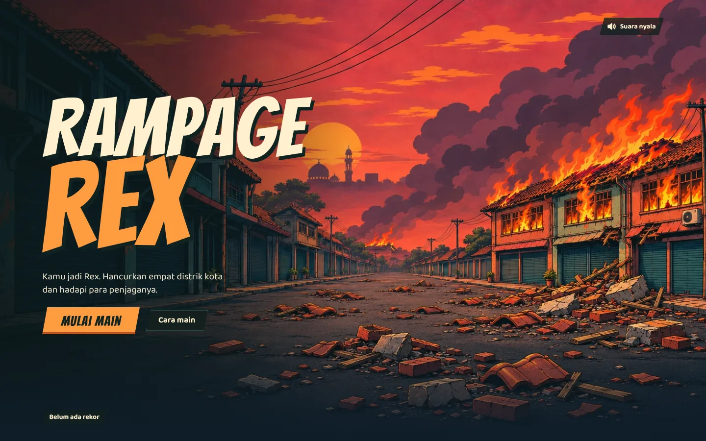
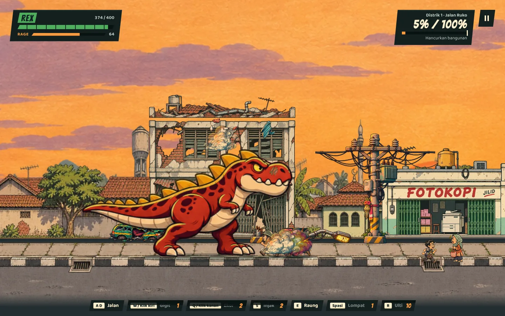
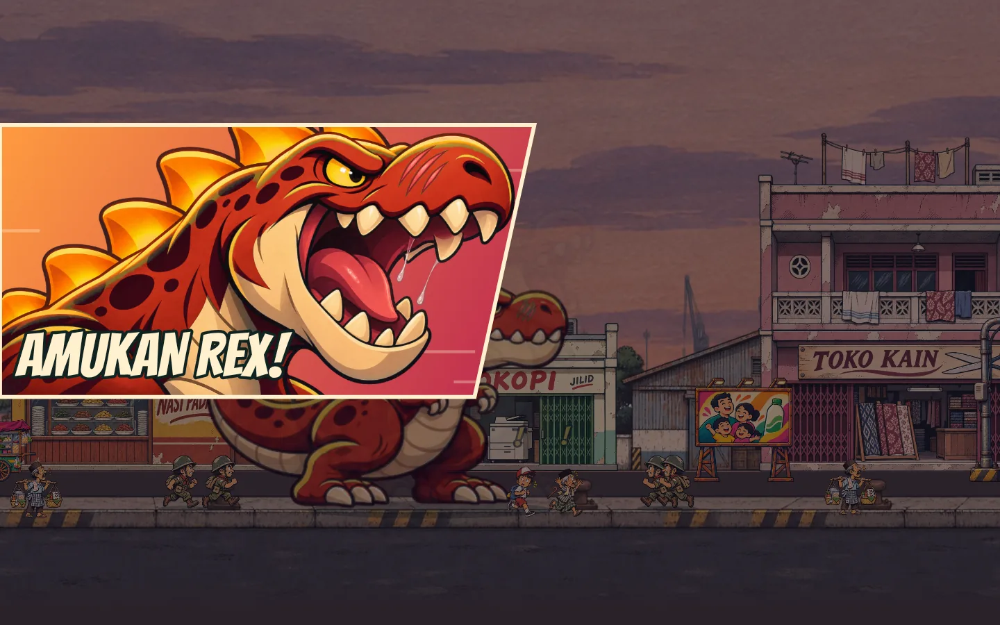
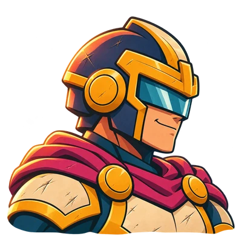
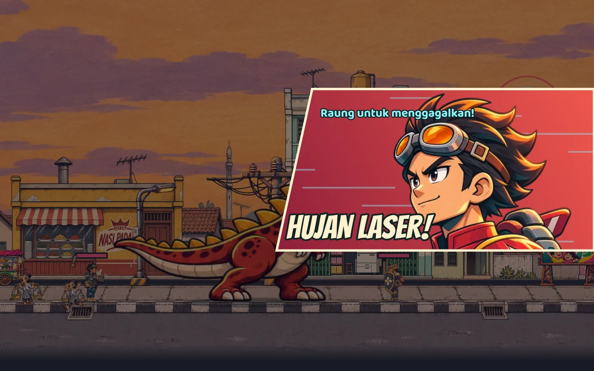
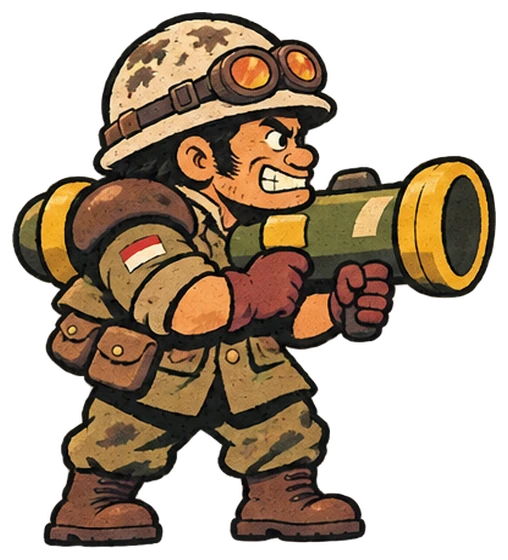
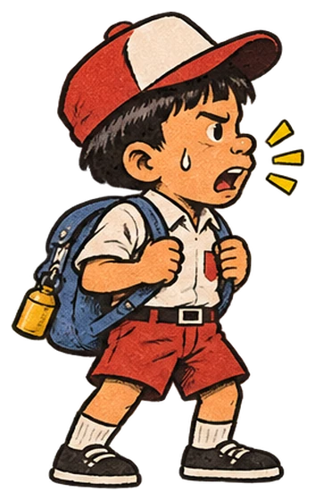
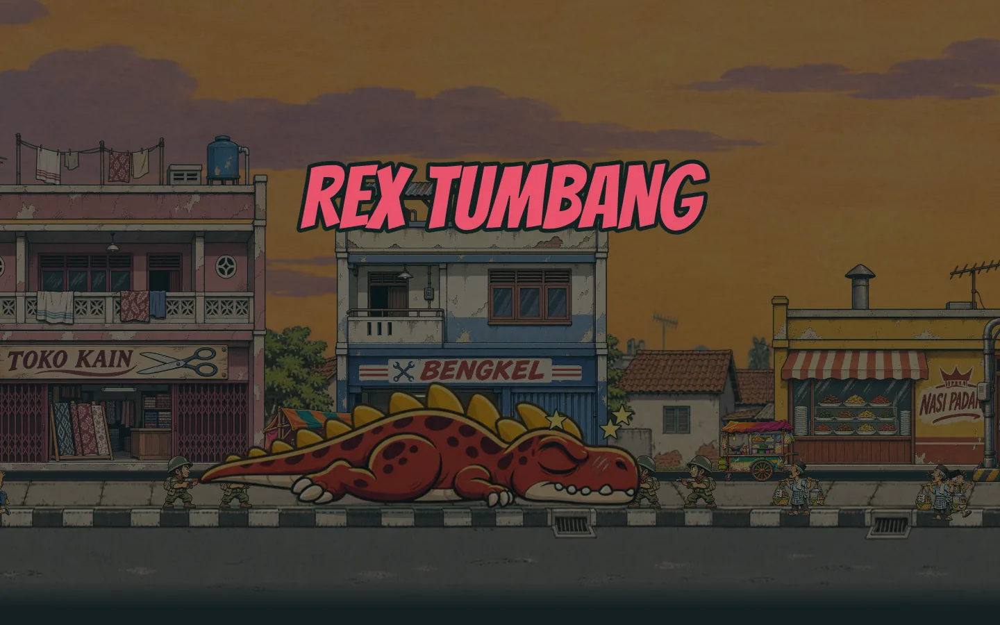
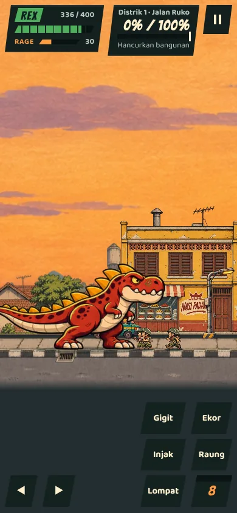

# Rampage Rex

**Game 2D di browser: kamu jadi Rex, dan kota Ruko Senja ada di depanmu.**

Ratakan bangunan lantai demi lantai, hadapi gerombolan tentara, dan kalahkan tiga pahlawan penjaga kota di empat distrik.

Bisa dimainkan dengan keyboard, mouse, atau layar sentuh.

  
  

---

## Kisahnya

Suatu malam, sebuah meteor jatuh di hutan pinggir kota. Di dasar kawahnya ada sebutir telur, dan dari telur itu menetas Rex. Ia tumbuh besar di hutan sampai hutan tidak lagi cukup, lalu di kejauhan ia melihat kota.

Kisah ini diceritakan lewat opening komik bergerak setelah kamu menekan **Mulai main**.

## Tujuan

Di setiap distrik:

1. **Ratakan 100% bangunan.** Runtuhkan lantai dasar untuk menjatuhkan semua lantai di atasnya.
2. **Kalahkan ketiga pahlawan penjaga.** Mereka datang bersamaan begitu kota cukup hancur.
3. **Jalan ke ujung distrik.** Tentara kabur dan panah muncul di ujung jalan. Bawa Rex ke sana, lalu ia berjalan keluar layar menuju distrik berikutnya.

Kalau darah Rex habis, Rex terhuyung lalu tumbang, dan distrik diulang dari awal.

## Kontrol

| Aksi | Keyboard | Mouse | Cooldown |
| --- | :-: | :-: | :-: |
| Jalan | `A` `D` atau `←` `→` | | |
| **Gigit** di depan, mengenai lantai teratas | `W` | Klik kiri | 0,7 dtk |
| **Ekor** ke belakang, melempar tentara dan jeep | `Q` | Klik kanan | 2,2 dtk |
| **Injak** di sekitar kaki, merusak lantai dasar | `S` | | 3,5 dtk |
| **Raung**, membuat tentara di layar terpaku | `E` | | 9 dtk |
| **Lompat gertakan**, kebal di udara dan membuat semua di layar terpaku saat mendarat | `Spasi` | | 20 dtk |
| **Ulti: Amukan Rex**, mengguncang seluruh layar | `R` | | 40 dtk |
| Jeda | `Esc` atau `P` | | |

Di HP atau tablet, pakai tombol arah dan tombol aksi di bagian bawah layar.

  
  

### Tips

- Chip skill di bawah layar menampilkan sisa detik cooldown. Lompat baru bisa dipakai 6 detik dan Ulti 15 detik setelah distrik dimulai.
- Serangan yang ditekan sedikit terlalu cepat tetap keluar begitu Rex bebas.
- Rex punya 400 darah. Mengalahkan tentara memulihkan sedikit darah, mengalahkan pahlawan memulihkan lebih banyak.
- Saat **Rage** penuh, damage Rex dua kali lipat selama 8 detik. Rage terisi dari menghancurkan bangunan dan mengalahkan musuh.
- Pakai **lompat** untuk menghindari tembakan: Rex kebal selama di udara, dan saat mendarat tentara terpaku 4,5 detik, pahlawan 1,6 detik.
- Musuh makin keras di distrik berikutnya. Jangan diam terlalu lama di depan barisan tembak.

## Para penjaga kota

<table>
  <tr>
    <td align="center" width="33%"> <b>Perisai</b></td>
    <td align="center" width="33%"> <b>Rajawali</b></td>
    <td align="center" width="33%"> <b>Jaring</b></td>
  </tr>
  <tr>
    <td valign="top">Menghadang di depan, menubruk dengan perisai, dan memblokir gigitan dari depan.  <b>Kelemahan:</b> hindari tubrukannya, lalu sabet dengan ekor saat ia lengah.</td>
    <td valign="top">Menyerang dari udara dengan jetpack, menembak laser, lalu menukik.  <b>Kelemahan:</b> raung atau lompat untuk menjatuhkannya, lalu gigit saat ia di tanah.</td>
    <td valign="top">Memotong jalan mundur, memasang turret, dan menembakkan jaring baja yang memperlambat Rex.  <b>Kelemahan:</b> hancurkan turretnya dulu, lalu injak.</td>
  </tr>
</table>

Ketiganya selalu datang bersamaan dan mengepung Rex. Tiap penjaga juga punya **ulti**:

| Penjaga | Ulti | Efek |
| --- | --- | --- |
| Perisai | **Benteng Baja** | Gelombang kejut sepanjang jalan, damage besar dan membuat Rex terpaku |
| Rajawali | **Hujan Laser** | Laser berjatuhan di sekitar Rex selama 1,5 detik |
| Jaring | **Jaring Raksasa** | Jaring baja menutupi Rex, damage dan memperlambat 5 detik |

Hanya satu penjaga yang bisa memakai ulti dalam satu waktu. Saat panelnya muncul, **raung**, **lompat**, atau pakai **Ulti Rex** untuk menggagalkannya.

  

## Tentara

<table>
  <tr>
    <td align="center"> <b>Infanteri</b> sejak awal</td>
    <td align="center"> <b>Bazooka</b> destruksi 30%</td>
    <td align="center"> <b>Jeep</b> destruksi 50%</td>
    <td align="center"> <b>Helikopter</b> destruksi 70%</td>
  </tr>
</table>

Tentara datang beregu dari depan dan belakang sampai belasan orang di layar, jadi Rex selalu dikeroyok. Makin hancur kotanya, makin besar regunya dan makin berat senjatanya. Helikopter hanya bisa digigit saat terbang rendah.

## Warga

  
  
  
  
  
  

Sebelum Rex datang, warga beraktivitas di jalan: mengobrol, menunggu di depan toko, atau berjualan di dekat gerobak. Begitu Rex mendekat atau bangunan di dekat mereka diserang, mereka panik dan berlarian. Warga tidak menyerang, tapi bisa dikalahkan: serangan pertama membuat mereka terhuyung, serangan kedua melempar mereka keluar layar.

  

## Empat distrik

| | Distrik | Suasana |
| :-: | --- | --- |
| 1 | **Jalan Ruko** | Deretan ruko, warung, dan angkot saat senja |
| 2 | **Pusat Kota** | Gedung perkantoran dan Tugu Kujang di kejauhan |
| 3 | **Pelabuhan** | Gudang, kontainer, dan derek pelabuhan |
| 4 | **Alun-Alun** | Pusat kota di malam hari, tempat pertarungan terakhir |

Setiap distrik punya bangunan Kopdes Merah Putih yang mengeluarkan para pekerjanya saat diserang, dengan truk SPPG terparkir di depannya. Truk, angkot, gerobak, tiang listrik, dan properti jalan lain juga bisa diremukkan untuk tambahan skor. Para penjaga datang saat destruksi mencapai 25% di distrik 1, lalu makin lambat di distrik berikutnya. Darah mereka juga makin tebal.

  
  

## Lisensi

Kode dan aset game ini berlisensi [MIT](LICENSE) © 2026 Cendy Saputra, kecuali huruf Bangers dan Baloo 2 di `assets/fonts/` yang memakai SIL Open Font License 1.1.
