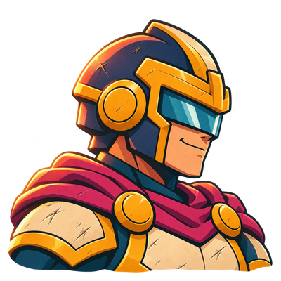
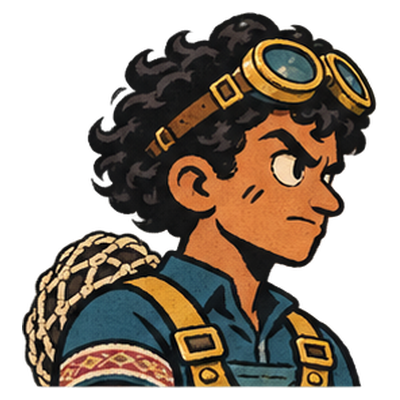
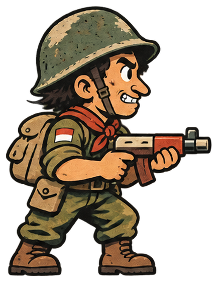
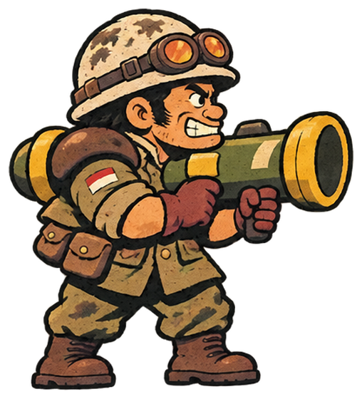
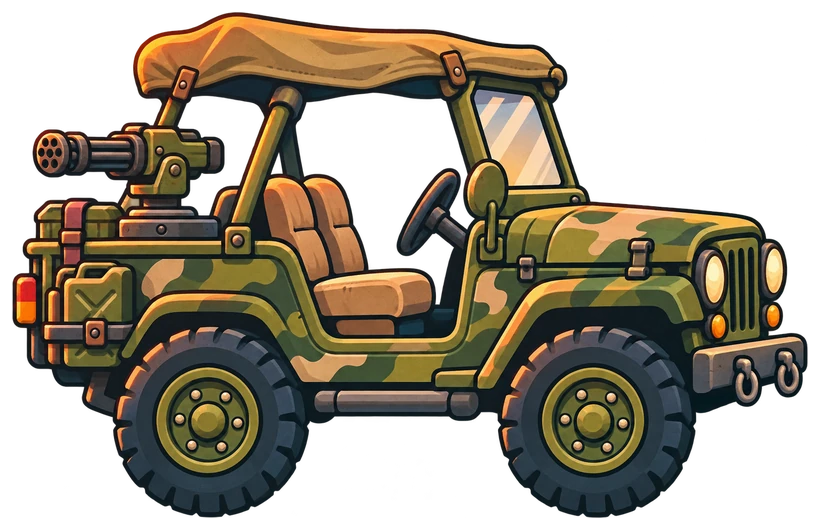
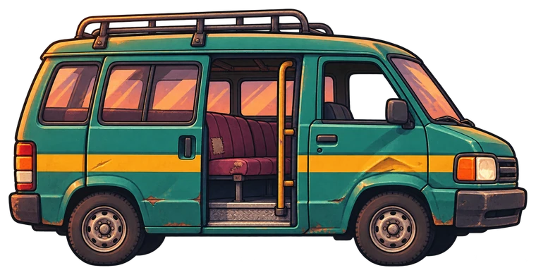
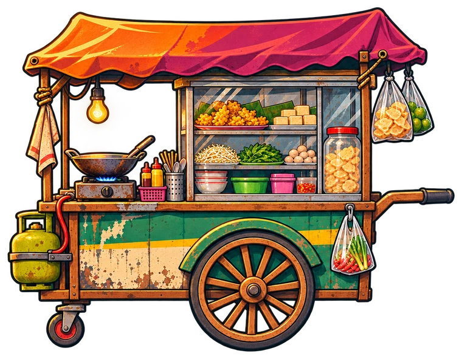
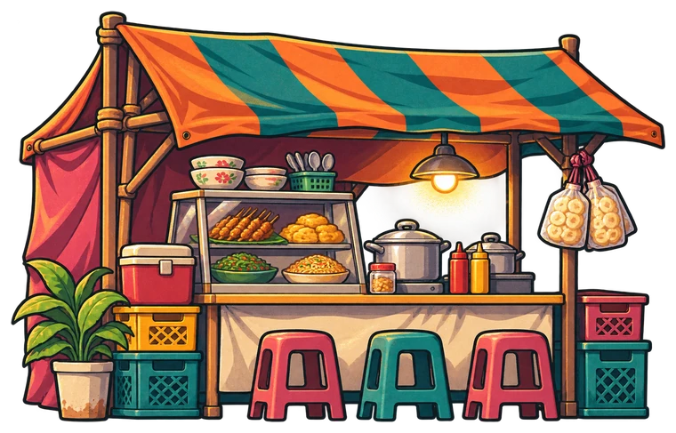
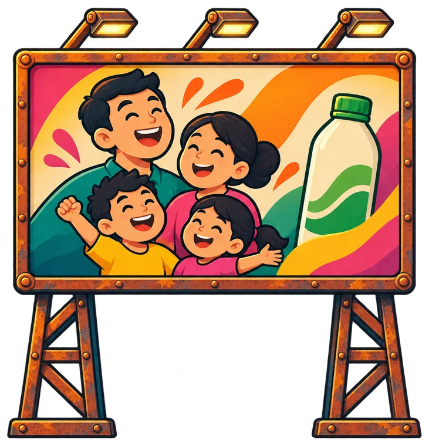

<div align="center">


#  Rampage Rex

**Game 2D di browser: kamu jadi Rex, dan kota Ruko Senja ada di depanmu.**

Hancurkan bangunan lantai demi lantai, hadapi tentara, dan kalahkan para pahlawan penjaga di empat distrik.

HTML5 Canvas · JavaScript murni · tanpa build · keyboard, mouse, dan layar sentuh

</div>

---

## 🎮 Cara main

Dari root repo, jalankan server statis apa saja, misalnya:

```
python -m http.server 8000
```

Lalu buka `http://localhost:8000`. Game membaca modul JavaScript, data level, dan aset lewat HTTP, jadi tidak bisa dibuka langsung sebagai file. Tidak ada paket yang perlu dipasang.

Tujuan tiap distrik: **capai target destruksi** dan **kalahkan semua pahlawannya**. Kalau HP Rex habis, distrik diulang.

## 🕹️ Kontrol

| | Aksi | Keyboard | Mouse | Cooldown |
| :-: | --- | :-: | :-: | :-: |
| 🚶 | Jalan | `A` `D` atau `←` `→` | | |
| 🦷 | **Gigit** di depan, mengenai lantai teratas | `W` | Klik kiri | 0,7 dtk |
| 🌀 | **Ekor** ke belakang, melempar tentara dan jeep | `Q` | Klik kanan | 2,2 dtk |
| 🦶 | **Injak** di sekitar kaki, merusak lantai dasar | `S` | | 3,5 dtk |
| 📣 | **Raung**, membuat tentara di layar terpaku | `E` | | 9 dtk |
| 💥 | **Ulti: Amukan Rex**, mengguncang seluruh layar | `R` | | 40 dtk |
| ⏸️ | Jeda | `Esc` atau `P` | | |

- Chip skill di bawah layar meredup dan menampilkan sisa detik selama cooldown berjalan. Ulti baru bisa dipakai 15 detik setelah distrik dimulai.
- Serangan yang ditekan sedikit terlalu cepat tetap keluar begitu Rex bebas.
- Meruntuhkan lantai dasar menjatuhkan semua lantai di atasnya.
- Rex punya 400 darah. Mengalahkan tentara memulihkan sedikit, mengalahkan pahlawan memulihkan lebih banyak.
- Peluru, roket, dan serangan pahlawan cukup sakit, dan damage-nya naik 12% di tiap distrik berikutnya. Jangan diam terlalu lama di depan barisan tembak.
- Tiap pahlawan punya bar darah di atas kepalanya dan di pojok kanan atas layar.
- Saat **Rage** penuh, damage Rex dua kali lipat selama 8 detik.
- Di layar sentuh, pakai tombol arah dan tombol aksi di bagian bawah. Rekor skor tersimpan di browser.

## 🦸 Para penjaga kota

<table>
  <tr>
    <td align="center" width="33%"><br><b>🛡️ Perisai</b></td>
    <td align="center" width="33%"><br><b>🦅 Rajawali</b></td>
    <td align="center" width="33%"><br><b>🕸️ Jaring</b></td>
  </tr>
  <tr>
    <td valign="top">Menubruk dengan perisai dan memblokir gigitan dari depan.<br><br><b>Kelemahan:</b> hindari tubrukannya, lalu sabet dengan ekor saat ia lengah.</td>
    <td valign="top">Terbang dengan jetpack, menembak laser, lalu menukik.<br><br><b>Kelemahan:</b> raung untuk menjatuhkannya, lalu gigit saat ia di tanah.</td>
    <td valign="top">Memasang turret dan menembakkan jaring baja yang memperlambat Rex.<br><br><b>Kelemahan:</b> hancurkan turretnya dulu, lalu injak.</td>
  </tr>
</table>

Tiap penjaga juga punya **ulti** dengan cut-in panel yang sama seperti Amukan Rex, masuk dari kanan layar:

| Penjaga | Ulti | Efek |
| --- | --- | --- |
| 🛡️ Perisai | **Benteng Baja** | Gelombang kejut sepanjang jalan, damage besar dan membuat Rex terpaku |
| 🦅 Rajawali | **Hujan Laser** | Laser berjatuhan dari langit di sekitar Rex selama 1,5 detik |
| 🕸️ Jaring | **Jaring Raksasa** | Jaring baja menutupi Rex, damage dan memperlambat 5 detik |

Hanya satu penjaga yang bisa memakai ulti dalam satu waktu. **Raung** saat panelnya muncul, atau pakai Ulti Rex, untuk menggagalkannya.

## 🪖 Tentara dan warga

<table>
  <tr>
    <td align="center"><br><b>Infanteri</b><br>sejak awal</td>
    <td align="center"><br><b>Bazooka</b><br>destruksi 30%</td>
    <td align="center"><br><b>Jeep</b><br>destruksi 50%</td>
    <td align="center"><br><b>Helikopter</b><br>destruksi 70%</td>
  </tr>
</table>

Makin hancur kotanya, makin berat perlawanannya. Helikopter hanya bisa digigit saat terbang rendah.

<p align="center">
  
  
  
  
  
</p>

Warga sipil berlarian panik dan tidak menyerang. Gigitan, sabetan ekor, injakan, dan Ulti Rex bisa melempar mereka keluar layar, menambah skor dan sedikit Rage.

## 🏙️ Empat distrik

| | Distrik | Target destruksi | Para penjaga datang di |
| :-: | --- | :-: | :-: |
| 1 | Jalan Ruko | 60% | 25% |
| 2 | Pusat Kota | 70% | 35% |
| 3 | Pelabuhan | 75% | 45% |
| 4 | Alun-Alun | 80% | 50% |

Di setiap distrik, Perisai, Rajawali, dan Jaring selalu datang bertiga dan mengepung Rex: Perisai menghadang di depan, Rajawali menyerang dari udara, Jaring memotong jalan mundur. Darah mereka makin tebal di distrik berikutnya.

<p align="center">
  
  
  
  
  
</p>

Susunan bangunan, properti jalan, titik muncul tentara, dan jadwal pahlawan tiap distrik diatur di `data/levels/`.

## 📁 Struktur proyek

| Lokasi | Isi |
| --- | --- |
| `index.html`, `style.css` | Halaman, menu, dan HUD |
| `src/main.js` | Alur layar, input, dan HUD |
| `src/world.js` | Aturan permainan: Rex, musuh, bangunan, cooldown, ulti |
| `src/art.js` | Pemuatan gambar dan renderer canvas |
| `src/rex-animation.js`, `src/motion.js` | Pemilihan pose Rex dan kurva gerak |
| `src/audio.js` | Efek suara Web Audio |
| `data/levels/` | Data empat distrik |
| `assets/backgrounds/` | Latar bersama, plus satu folder per distrik bila punya latar sendiri |
| `assets/` | Gambar dan `manifest.json` |
| `tools/` | Konversi WebP dan skrip pemeriksaan |
| `image-prompts.md` | Arah visual dan prompt pembuatan gambar |

## 🖼️ Aset

Game memuat salinan WebP dari gambar di `assets/` (lihat `imageFormat` di `assets/manifest.json`). Repo hanya menyimpan WebP untuk gambar yang dipakai game; PNG sumbernya ada di riwayat git. Untuk menambah atau mengganti gambar, taruh PNG barunya di folder yang sama, daftarkan di manifest, lalu jalankan `python tools/to-webp.py` dari root repo (butuh Pillow). PNG boleh dihapus setelah hasil WebP-nya diperiksa. Potret, ilustrasi master, dan ikon halaman tetap berformat PNG karena tidak digambar di canvas.

Renderer memangkas ruang transparan saat decode berdasarkan `bounds` di manifest, lalu menggambar dengan pivot asli. Perbarui bounds dan pivot jika bentuk aset berubah. Latar disiapkan ulang saat ukuran layar berubah; langit dan jalan mempertahankan proporsinya pada layar portrait.

Huruf UI memakai Bangers (judul dan seruan) dan Baloo 2 (teks), keduanya berlisensi SIL Open Font License 1.1. File huruf dan lisensinya ada di `assets/fonts/`.

Rex digambar dari pose di `assets/characters/rex/animations/`; catatan pembuatannya ada di [README folder itu](assets/characters/rex/animations/README.md).

## ✅ Pemeriksaan

Jalankan `npm run check` (atau `node tools/check-motion.mjs`) dengan Node.js 16 atau lebih baru. Tidak ada paket yang perlu dipasang; `package.json` hanya menandai file `.js` sebagai modul ES. Pemeriksaan ini menguji waktu benturan, perpindahan pose, pendaratan Rajawali, serta konsistensi gerak pada simulasi 30, 60, 120, dan 144 Hz.

Untuk pemeriksaan browser, jalankan server lokal lalu `node tools/preview-browser.mjs` dari environment yang menyediakan Playwright dan Chromium. Jika Playwright terpasang di luar repo, arahkan variabel `PLAYWRIGHT_PATH` ke file `index.mjs` paket tersebut. `REX_URL` dapat mengganti alamat server, dan `REX_PREVIEW_DIR` dapat mengganti lokasi hasil. Secara default, screenshot dan `results.json` disimpan dalam folder `rampage-rex-preview` di direktori temporer sistem.

Hasil pemeriksaan perubahan gambar dan animasi dicatat di [docs/animation-checks.md](docs/animation-checks.md).

## 📄 Lisensi
Kode dan aset game ini berlisensi [MIT](LICENSE) © 2026 Cendy Saputra, kecuali huruf di `assets/fonts/` yang tetap memakai SIL Open Font License 1.1.
